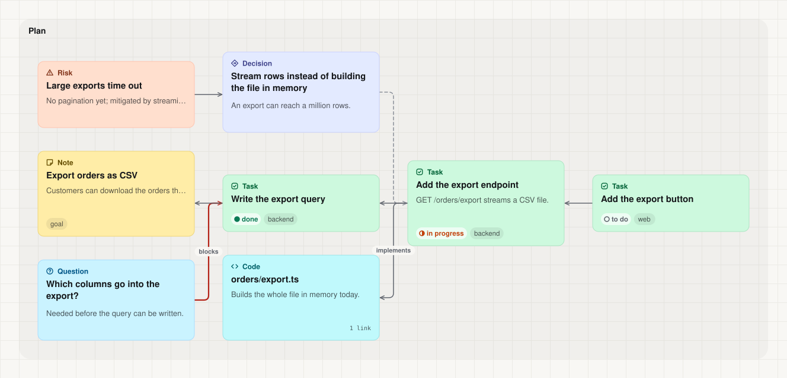
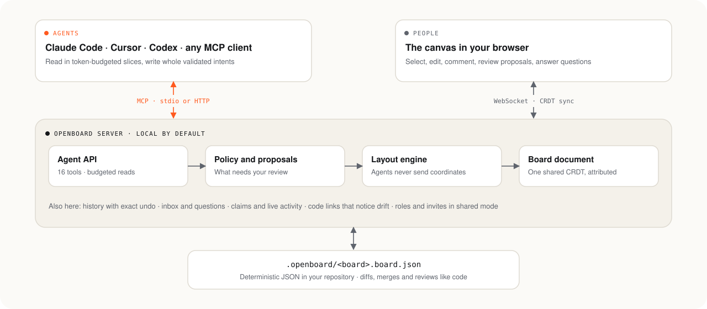

<p align="center">
  <picture>
    <source media="(prefers-color-scheme: dark)" srcset="assets/banner-dark.svg">
    
  </picture>
</p>

<p align="center">
  <a href="LICENSE"></a>
  
  
  
</p>

<p align="center">
  <a href="#quick-start">Quick start</a> ·
  <a href="#connect-your-agent">Connect your agent</a> ·
  <a href="#what-you-get">What you get</a> ·
  <a href="#how-it-works">How it works</a> ·
  <a href="#documentation">Docs</a>
</p>

> [!NOTE]
> OpenBoard is free to use, change and share for personal and other noncommercial purposes under the [PolyForm Noncommercial License](LICENSE). Commercial use needs a separate license. It is pre-release: nothing is published to a package registry yet.

# OpenBoard

**A shared canvas that your AI agent can read, edit, and be steered from.**

Run OpenBoard in a project and the agent you already use — Claude Code, Cursor, Codex, or any other [MCP](https://modelcontextprotocol.io) client — can map your code, lay out a plan, and keep it current on a board you both see. You steer by pointing: select cards, comment, accept or reject what the agent proposes, and answer its questions right on the canvas.

OpenBoard does not build agents. It is the surface between you and yours.

<p align="center">
  <picture>
    <source media="(prefers-color-scheme: dark)" srcset="assets/example-board-dark.svg">
    
  </picture>
  <br>
  <sub>A real board, exported with <code>openboard export --format svg</code>. The file behind it is <a href="examples/boards/orders-export.board.json">a few kilobytes of readable JSON</a>.</sub>
</p>

## Why

| Without a shared board                          | With OpenBoard                                              |
| ----------------------------------------------- | ----------------------------------------------------------- |
| An agent's plan scrolls away in the chat        | The plan lives on a board that persists and stays current   |
| You steer by typing long instructions           | You select cards and say "these"                            |
| An agent edits your work and you find out later | Changes to your work wait as proposals you accept or reject |
| You cannot tell what five subagents are doing   | Every agent shows what it is reading, writing, or running   |
| Diagrams rot the moment the code changes        | Cards linked to code are flagged when that code changes     |
| Whiteboards are tied to one vendor's assistant  | Any agent that speaks MCP works                             |

## Quick start

You need Node.js 22 or newer. OpenBoard is not on a package registry yet, so run it from a clone:

```bash
git clone https://github.com/asasemahmed/openboard.git
cd openboard
corepack enable
pnpm install
pnpm build
alias openboard="node $PWD/packages/cli/dist/bin.js"
```

Then, in any project:

```bash
cd /path/to/your/project
openboard start
```

The board opens in your browser. Press `N` for a note, `T` for a task, `Cmd/Ctrl+K` to search and run commands, or start from a template. [Getting started](docs/getting-started.md) walks through the rest.

## Connect your agent

### Let your agent do it

Open your project in any coding agent that can run commands — OpenCode, Cline, Claude Code, Cursor, Codex, Gemini CLI, Windsurf, GitHub Copilot, Zed — and paste this prompt. The agent installs OpenBoard, connects itself, and checks that it works.

```text
Set up OpenBoard (https://github.com/asasemahmed/openboard) for this project and connect yourself to it.

1. Run `node --version`. If Node.js is missing or older than 22, stop and tell me.
2. If ~/openboard does not exist, run `git clone https://github.com/asasemahmed/openboard.git ~/openboard`.
   Then, inside ~/openboard, run `corepack pnpm install` and `corepack pnpm build`.
3. Back in this project, run `node ~/openboard/packages/cli/dist/bin.js connect generic`.
   It prints a stdio command with absolute paths. Use that exact command; do not change the paths.
4. Add an MCP server named "openboard" that runs that command to your own MCP configuration,
   in the file and format your client uses (the project's configuration if your client has one).
   Keep every server that is already there. If ~/openboard/integrations has a folder for your
   client, follow its README instead.
5. Copy the guide between the openboard:guide markers in ~/openboard/integrations/generic/AGENT_GUIDE.md
   into the instructions file you read for this project (for example AGENTS.md or .clinerules).
6. Tell me what you changed, and whether I need to restart or reload you to load the new server.
7. When the board_ tools are available, call board_outline and show me the result. Then run
   `node ~/openboard/packages/cli/dist/bin.js status` and give me the board's URL to open.
```

The MCP server starts the board server for the project on first use, so there is nothing else to keep running.

### Or set it up yourself

After the [quick start](#quick-start), run this in your project:

```bash
openboard connect
```

It prints the exact command for your project, with absolute paths. Put it in your client's configuration.

**Claude Code** — one line:

```bash
claude mcp add openboard -- node /path/to/openboard/packages/cli/dist/bin.js mcp
```

**OpenCode** — `opencode.json` in the project:

```json
{
  "$schema": "https://opencode.ai/config.json",
  "mcp": {
    "servers": {
      "openboard": {
        "type": "local",
        "command": [
          "node",
          "/path/to/openboard/packages/cli/dist/bin.js",
          "mcp",
          "--root",
          "/path/to/your/project"
        ]
      }
    }
  }
}
```

Older OpenCode versions put the server directly under `mcp`, without `servers`.

**Cline** — open the MCP Servers panel, choose **Configure MCP Servers**, and add to `cline_mcp_settings.json`:

```json
{
  "mcpServers": {
    "openboard": {
      "command": "node",
      "args": [
        "/path/to/openboard/packages/cli/dist/bin.js",
        "mcp",
        "--root",
        "/path/to/your/project"
      ]
    }
  }
}
```

**Other clients** take the same `command` and `args`:

| Client         | File                                  | Where the server goes                 |
| -------------- | ------------------------------------- | ------------------------------------- |
| Cursor         | `.cursor/mcp.json`                    | `mcpServers`                          |
| Codex          | `~/.codex/config.toml`                | `[mcp_servers.openboard]`             |
| Gemini CLI     | `.gemini/settings.json`               | `mcpServers`                          |
| Windsurf       | `~/.codeium/windsurf/mcp_config.json` | `mcpServers`                          |
| GitHub Copilot | `.vscode/mcp.json`                    | `servers`, with `"type": "stdio"`     |
| Zed            | Zed's `settings.json`                 | `context_servers`                     |
| Anything else  | Your client's MCP settings            | stdio, or `http://127.0.0.1:4747/mcp` |

If `node` is not on the path your client starts servers with, use the absolute Node.js path that `openboard connect` prints. Setups that also teach the agent how to work on a board — a plugin with a skill for Claude Code, a rule for Cursor, a snippet for Codex, and a generic guide for everything else — are in [`integrations/`](integrations/README.md).

Then try:

- "Map this repository's architecture on the board."
- "Plan the CSV export feature on the board, with risks and open questions."
- Select a few cards, then: "Group these into a frame and add what is missing."

## What you get

### For your agent

- **Budgeted reads.** An agent looks at an outline first, then reads a frame, your selection, a search result, or only what changed since it last looked. Every read takes a token budget and says when it left something out.
- **Intent writes.** One batch creates a connected structure, with references between the nodes it adds. The batch is validated as a whole and applied atomically; errors name the operation and say what would be valid.
- **No coordinates.** Agents edit meaning. The layout engine places what they add and never moves what you placed.
- **Feedback.** An inbox carries your mentions, replies, answers, and review decisions with your note. An agent can ask you a question on the canvas and wait for the answer.
- **A small tool surface.** Sixteen tools whose names, descriptions and schemas fit in about 3,500 tokens. A test fails if they grow past a ceiling.

<details>
<summary><b>The sixteen tools</b></summary>

| Tool                         | What it is for                                                          |
| ---------------------------- | ----------------------------------------------------------------------- |
| `board_list`, `board_create` | Find or create a board, optionally from a template                      |
| `board_outline`              | The cheap first look: frames and counts                                 |
| `board_read`                 | A slice: by ids, frame, selection, type, status, tags, text, neighbours |
| `board_changes`              | What happened since the agent last looked, and who did it               |
| `board_selection`            | What you are pointing at right now                                      |
| `board_apply`                | A validated, atomic batch of operations                                 |
| `board_layout`               | Tidy a board or a frame                                                 |
| `board_inbox`                | Mentions, replies, answers, review decisions; can wait for one          |
| `board_comment`              | Comment, reply, or resolve a thread                                     |
| `board_ask`                  | Put a question or approval request on the canvas and wait               |
| `board_undo`                 | Take back the agent's own change, or withdraw a proposal                |
| `board_claim`                | Mark nodes as being worked on so other agents stay off them             |
| `board_links`                | Which cards describe code that has changed                              |
| `board_schema`               | The node and edge types available, including your own                   |
| `board_template`             | Start a structure from a template                                       |

Full reference: [docs/tools.md](docs/tools.md).

</details>

### For you

- **Review on the canvas.** By default an agent adds freely and edits its own work freely, while changes to anyone else's content arrive as proposals: dashed ghosts with Accept and Reject, decided as a whole or item by item, with an optional note back to the agent. Four policy modes per agent, and a frame can be opened up, protected, or locked.
- **Exact undo.** Every change is a batch with an author and a reason. Undo restores exactly what was there and never overwrites later work.
- **See agents at work.** Agents appear among the participants with what they are reading, writing, or running. A recorder hook shows the whole session tree, subagents included. Replay scrubs through how the board came to be.
- **A conversation in context.** Comment threads on cards, mentions, and question cards from agents with one-click answers.

### For your repository

- **Boards are files.** Each board is deterministic JSON in `.openboard/`: a small change to the board is a small diff.
- **Merged by meaning.** `openboard git setup` installs a merge driver that merges at field level, never writes conflict markers, and never drops an edit.
- **Reviewable.** `openboard diff` shows what changed between revisions as text, markdown, or an SVG that draws what was added, changed, and removed. The canvas can compare the live board with any revision.
- **Code-aware.** A card linked to a file or a line range follows the code when it moves and is flagged when it changes.
- **In and out.** Export to JSON, Markdown, Mermaid, JSON Canvas, and SVG. Import Mermaid flowcharts and JSON Canvas files.

### For your team

- **Shared mode.** `openboard start --share` lets people and agents on other machines join with invite links and tokens. Roles — owner, editor, commenter, viewer — are enforced on every request and on the sync connection, and access can be revoked at once. It stays opt-in; the default is local only.
- **Claims.** On a board shared by several agents, a claim keeps them out of each other's way and expires on its own.

### Make it yours

- **Your own types.** Declare node and edge types with typed fields in `.openboard/config.json`. They get proper cards and forms, validation, and a description agents can read.
- **Templates.** Eight built in — feature plan, architecture map, release plan, incident review, decision record, research map, kanban, agent team — plus any board you save as a project template.
- **Plugins.** Add types, templates, exporters, importers, and a hook after each change. Plugins are loaded only when you name them with `--plugin`; nothing is ever loaded from a project on its own.

## How it works

<p align="center">
  <picture>
    <source media="(prefers-color-scheme: dark)" srcset="assets/architecture-dark.svg">
    
  </picture>
</p>

Three ideas carry the design:

1. **Structure over pixels.** The board is a typed graph of nodes, edges, and frames. Agents edit meaning; the layout engine places things and leaves alone what you placed.
2. **Budgeted reads, intent writes.** An agent never receives more of the board than it asked for, and never writes half an idea.
3. **The board is shared ground.** People and agents edit one document. Every change is attributed, everyone sees it as it happens, and text on the board is treated as data, not as instructions.

The details, including the contracts between packages, are in [docs/ARCHITECTURE.md](docs/ARCHITECTURE.md).

## Measured, not assumed

OpenBoard ships an [evaluation harness](docs/evals.md) that gives an agent a task through the real MCP server and scores the board it leaves behind and what it cost.

| Measure                                                                                    | Result                                                                          |
| ------------------------------------------------------------------------------------------ | ------------------------------------------------------------------------------- |
| Tool list an agent loads once per connection                                               | about 3,500 tokens for 16 tools                                                 |
| Find and update one card on a 500-card board                                               | about 220 tokens of board output; reading the whole board would be about 41,000 |
| Scenarios in the suite                                                                     | 12, each with a scripted reference that must score 1.0                          |
| A small model on four scenarios (mapping a repo, a large board, review, untrusted content) | 1.00 on each, at 0.9× the reference's board tokens                              |
| Layout                                                                                     | 500 cards in about 0.2 s; 2,000 in about 0.5 s                                  |
| Recorder hook                                                                              | under 50 ms per agent tool call                                                 |

Token counts are estimates of board input and output at four characters per token. Run it yourself with `pnpm evals run --runner scripted`.

## Security

- **Local by default.** The server binds to loopback, checks `Host` and `Origin`, and has no remote access unless you start shared mode.
- **Board text is untrusted input.** Reads label who wrote what, and the agent guides say to treat it as content.
- **Shared mode** authenticates every request, takes identity from the access grant rather than from request headers, and syncs viewers and commenters read-only. It was reviewed independently; the findings and the known limits are in [docs/sharing.md](docs/sharing.md).
- **No implicit code loading.** Plugins run only when named on the command line.

To report a vulnerability, see [SECURITY.md](SECURITY.md).

## Documentation

| Guide                                          | What it covers                                                               |
| ---------------------------------------------- | ---------------------------------------------------------------------------- |
| [Getting started](docs/getting-started.md)     | Build, start, connect, first prompts                                         |
| [How agents work with a board](docs/agents.md) | Reads, writes, selection, review, undo, comments, questions, identity, trust |
| [Tool reference](docs/tools.md)                | Every tool, operation, validation error, and type                            |
| [CLI reference](docs/cli.md)                   | Every command and flag                                                       |
| [Board file format](docs/board-format.md)      | The `.board.json` file and `config.json`                                     |
| [Boards in git](docs/git.md)                   | Merging, readable diffs, reviewing board changes                             |
| [Templates](docs/templates.md)                 | The built-in templates and how to use them                                   |
| [Extending OpenBoard](docs/extending.md)       | Declared types, project templates, plugins                                   |
| [Sharing boards](docs/sharing.md)              | Shared mode, invites, roles, running it safely                               |
| [Evaluating agents](docs/evals.md)             | The harness, its baseline, and what it shows                                 |
| [Integrations](integrations/README.md)         | Claude Code, Cursor, Codex, and generic MCP setups                           |
| [Architecture](docs/ARCHITECTURE.md)           | How the packages fit together                                                |

## Project layout

| Path              | What it is                                                                                                   |
| ----------------- | ------------------------------------------------------------------------------------------------------------ |
| `packages/core`   | Schema, operations, the board document, queries, rendering, formats, merge. Runs in Node and in the browser. |
| `packages/server` | The local server: sync, persistence, layout, policy, history, code links, shared mode                        |
| `packages/mcp`    | The MCP tools, over stdio and Streamable HTTP                                                                |
| `packages/sdk`    | A typed HTTP client                                                                                          |
| `packages/cli`    | The `openboard` command                                                                                      |
| `packages/app`    | The web canvas                                                                                               |
| `packages/evals`  | The evaluation harness                                                                                       |
| `integrations/`   | Ready-made agent setups                                                                                      |
| `examples/`       | A sample plugin and a sample board                                                                           |

## Status

OpenBoard is pre-release software.

- It runs from a source checkout; it is not published to a package registry.
- The Claude Code setup is exercised end to end. The setups for the other clients were written from their documentation and not run inside those tools.
- Shared mode has not been run behind a real TLS proxy or tunnel yet.
- There is no PNG export (the SVG export is self-contained) and no board view inside chat clients.

## Contributing

Contributions are welcome. The [open issues](https://github.com/asasemahmed/openboard/issues) range from an afternoon's work to a new subsystem: [`good first issue`](https://github.com/asasemahmed/openboard/issues?q=is%3Aissue+is%3Aopen+label%3A%22good+first+issue%22) marks the small, well-scoped ones and [`help wanted`](https://github.com/asasemahmed/openboard/issues?q=is%3Aissue+is%3Aopen+label%3A%22help+wanted%22) the ones nobody is working on. Comment on an issue before you start so two people do not build the same thing.

For ideas, questions and boards you made, use [Discussions](https://github.com/asasemahmed/openboard/discussions).

See [CONTRIBUTING.md](CONTRIBUTING.md) for the development setup, commands, ground rules, and the terms your contribution is made under.

```bash
pnpm test        # every package
pnpm lint
pnpm typecheck
```

## License

OpenBoard is licensed under the [PolyForm Noncommercial License 1.0.0](LICENSE).

- **You may** use, change, and share it for personal use, research, hobby projects, education, and other noncommercial purposes, including inside charities, schools, and public institutions.
- **You may not** use it for commercial purposes without a separate license. To ask about one, open an issue.

This is a source-available license, not an open-source license as the Open Source Initiative defines the term.
