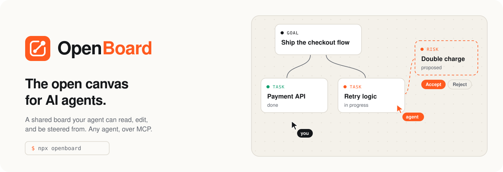

<p align="center">
  <picture>
    <source media="(prefers-color-scheme: dark)" srcset="assets/banner-dark.svg">
    
  </picture>
</p>

> [!NOTE]
> **This repository is private for now.** OpenBoard is being built in the open-source spirit from the first commit and will be made public under the MIT license once the foundation is ready. Nothing is released yet.

# OpenBoard

OpenBoard is an open canvas that AI agents read and edit over MCP while you edit it in the browser. Run it in a project, and the agent you already use — Claude Code, Cursor, Codex, or any other [MCP](https://modelcontextprotocol.io) client — can map your code, lay out a plan, and keep it current on a board you both see. The board is a typed graph of tasks, decisions, risks, questions and code, saved as a readable file in your repository. OpenBoard does not build agents; it is the shared surface between you and yours.

## What it does

- **A live canvas.** The board runs in your browser and stays in sync with everyone editing it. Changes made by others, people or agents, are highlighted as they arrive.
- **Agent tools over MCP.** Thirteen `board_*` tools to outline, read, change and lay out a board, and to talk with the people on it, over stdio or Streamable HTTP, with ready-made setups for Claude Code, Cursor and Codex.
- **Budgeted reads, atomic writes.** Agents read an outline, a slice or just what changed, within a token budget. They write whole intents as one batch that is validated and applied all at once, and the layout engine places what they add.
- **Selection as context.** Select cards on the canvas and say "these"; the agent sees what you selected.
- **You stay in control.** Decide per project and per agent what agents may change on their own; changes to your work wait as proposals you accept or reject, in whole or in part. Every change is recorded and can be undone exactly, without overwriting later work.
- **See agents at work.** Agents appear on the canvas next to the people: what they are reading, writing or running, including work outside the board reported by their hooks. Agents claim the nodes they work on so they do not collide, and you can replay how the board came to be.
- **Agents ask instead of guessing.** Agents put questions to you on the board and wait for the answer, read your comments and mentions in their inbox, and reply in the thread.
- **Boards in git.** Each board is a deterministic JSON file in `.openboard/`. It diffs and merges like code, and the server picks up changes from a checkout or a merge.

## Quick start

You need Node.js 22 or newer. From a clone of this repository:

```bash
corepack enable
pnpm install
pnpm build
alias openboard="node $PWD/packages/cli/dist/bin.js"
cd /path/to/your/project
openboard start
```

The board opens in your browser. [Getting started](docs/getting-started.md) walks through the canvas and your first prompts.

## Connect your agent

In your project, run:

```bash
openboard connect
```

It prints the exact setup for Claude Code, Cursor, Codex and any other MCP client. For a setup that also teaches the agent how to work on a board, use the plugin, rule or snippet in [`integrations/`](integrations/README.md).

## How it works

```
  Agents (Claude Code, Cursor, Codex, ...)           You (browser)
            |  MCP: stdio or HTTP                         |  WebSocket
            v                                             v
  +---------------------------------------------------------------+
  |                       openboard server                        |
  |   agent tools  ->  validation + layout  ->  board document    |
  +---------------------------------------------------------------+
                               |
                    .openboard/*.board.json  (in your repo)
```

Three ideas carry the design:

1. **Structure over pixels.** The board is a typed graph. Agents edit meaning; the layout engine places things, and leaves alone what you placed.
2. **Budgeted reads, intent writes.** Agents read an outline, a frame, the selection or what changed, never more than they asked for. They write whole intents that are validated before they land.
3. **The board is shared ground.** People and agents edit the same document. Every change is attributed, others see it as it happens, and board text is treated as data, not as instructions.

## Documentation

- [Getting started](docs/getting-started.md): build, start, connect, first prompts
- [How agents work with a board](docs/agents.md): the read and write paths, selection, cursors, review and undo, comments and questions, identity, trust
- [Tool reference](docs/tools.md): every tool, operation, validation error and type
- [CLI reference](docs/cli.md): every command and flag
- [Board file format](docs/board-format.md): the `.board.json` file and `config.json`, for reviewers and tool authors
- [Integrations](integrations/README.md): Claude Code, Cursor, Codex and generic MCP setups
- [Architecture](docs/ARCHITECTURE.md): how the packages fit together

## Development

See [CONTRIBUTING.md](CONTRIBUTING.md) for the development setup, commands and ground rules.

## License

[MIT](LICENSE)
